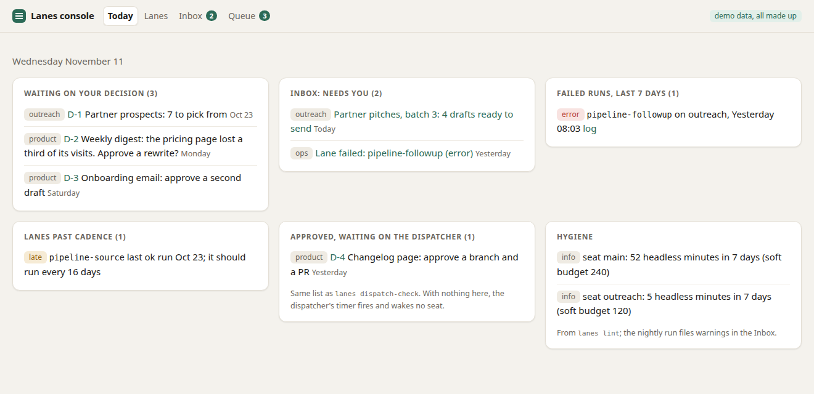
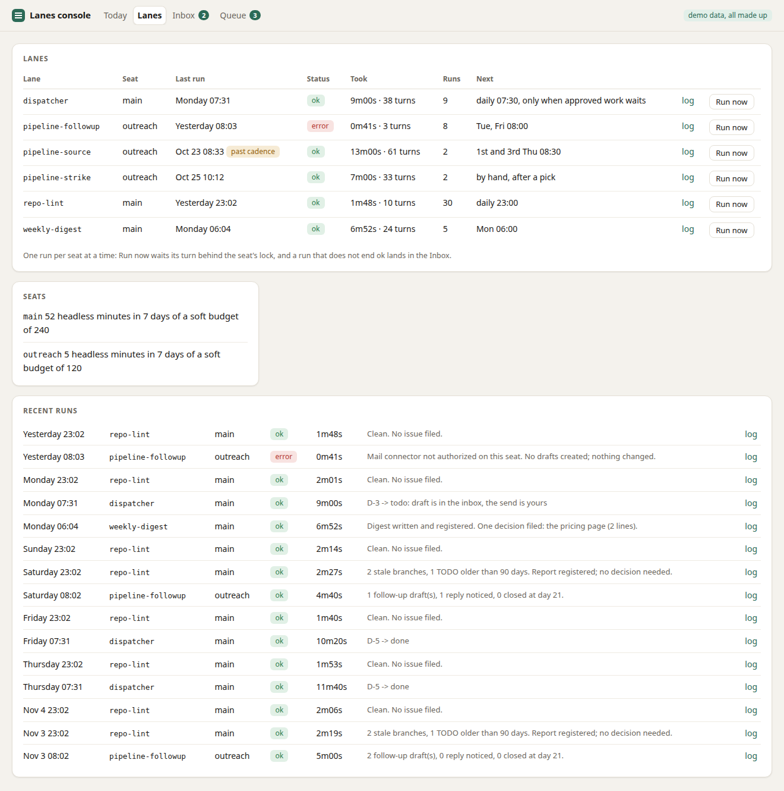
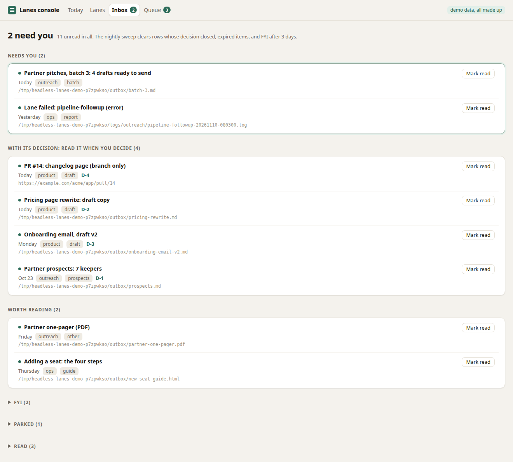
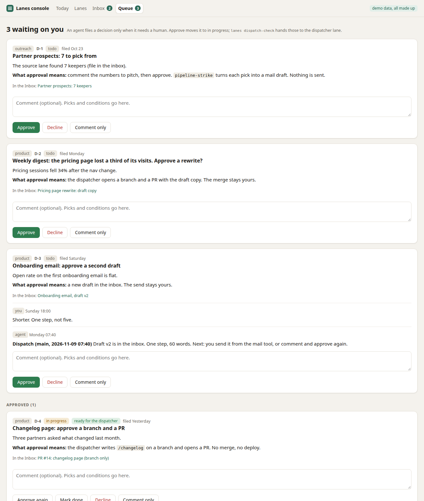

# headless-lanes

Claude Code agents that run on a schedule with nobody watching, and a human who approves
anything that leaves the building.

This is the scaffolding behind how I run agents every day, cut down to the parts worth
copying: a runner, a run log, one inbox for everything the agents make, a queue of decisions
that wait for me, and the guardrails that came out of things breaking. It is small on purpose. Bash, Python's standard library, SQLite and
systemd timers. No framework, no daemon, no npm.

Prompting an agent is the easy part. Leaving one alone at 6 a.m. and trusting what you find at 9
is the hard part, and that is what this repo is about.

## 30-second demo

```
git clone https://github.com/maxmillienjr/headless-lanes && cd headless-lanes
python3 console/console.py --demo
```

Open http://127.0.0.1:8787. The demo needs Python 3.11 or newer and nothing else. It seeds a
throwaway database (6 lanes, about 60 runs, an inbox, a queue) and deletes it on exit. Every
name and number in it is invented.

| Today | Lanes |
|---|---|
|  |  |

| Inbox | Queue |
|---|---|
|  |  |

Three things to try:

1. **Queue.** Approve D-2. In another terminal, paste the two lines the console printed at
   startup. `bin/lanes dispatch-check` now lists D-2, next to D-4, which the seed had
   already approved. That list is the only work a dispatcher lane will touch.
2. **Lanes.** Click Run now on two lanes that share a seat. The second waits for the first:
   one run per seat at a time. (The demo runs a stand-in that sleeps 3 seconds. No Claude
   seat is used.)
3. **Today.** One seeded run failed and one lane is past its cadence. Both are on the page
   without anyone having to go look.

## The shape

```
systemd timer
    |
    v
bin/lane-run.sh <seat> <lane>          one run per seat (flock); API key unset, so the
    |                                  run bills the seat's subscription
    v
claude -p "$(cat lanes/<lane>.md)"     the lane: a markdown prompt, run headless
    |
    +--> files ---------- lanes deliver ----> INBOX   (act / read / fyi / parked)
    |
    +--> needs a human -- lanes queue add --> QUEUE   (todo)
    |                                           |
    v                                           |  human: Approve
lane_runs row                                   v
(ok, error, timeout, locked)                 in_progress
    |                                           |
    |  not ok                                   |  lanes dispatch-check  (ExecCondition=:
    +--> INBOX, needs: act                      v   empty queue wakes no seat)
                                             dispatcher lane does the work, comments,
                                             and hands the decision back
```

Five words carry the whole thing:

- **Seat.** One Claude Code login with its own config directory, its own connectors and its
  own mailbox. A seat is a blast radius: give it the permissions its lanes need and no more.
- **Lane.** A markdown prompt plus a timer. The prompt says who it is, the job, the hard
  limits, and the one thing it finishes with. See [lanes/README.md](lanes/README.md).
- **Run log.** Every run is a row: seat, lane, duration, turns, tokens, status. That includes
  the run that never started because the seat was busy, the prompt was missing or the seat
  was logged out.
- **Inbox.** Everything an agent makes for a human is registered in the same step that makes
  it. The inbox sorts by what the human has to do, and a nightly sweep clears what no longer
  needs anyone.
- **Queue.** An agent files a decision only when it needs a human, with the consequence of
  approving spelled out. Approve moves it to `in_progress`. A dispatcher lane works those and
  nothing else.

## Autonomy tiers

| Tier | What | Examples |
|---|---|---|
| Just do it, then report | Reversible, stays inside | research, drafts, database writes, code on a branch |
| One tap from the human | Leaves the building | sends, posts, merges, deploys, money |
| Human only | Can't be delegated | calls, filings, anything that speaks for the person |

The shape of the work enforces the tiers. A lane ends in a draft, a PR or a decision, and the
tap stays with the human. Standing exceptions are written down with a cap
and a date. The long version is [docs/autonomy-tiers.md](docs/autonomy-tiers.md).

## What broke

Every guardrail here exists because something went wrong first. The list, with the failure
behind each one, is [docs/guardrails.md](docs/guardrails.md). Short version:

- In-place writes on a FUSE-mounted cloud drive zeroed a file, twice in one day. Now the
  database refuses to open on a network mount.
- Session-start hooks crashed on a second machine and seeded an empty database there. Now the
  hook never creates one.
- An API key left in a shell rc file switched Claude Code to per-token billing. Now the runner
  unsets it, and a test checks that.
- The hosted tracker's free plan stops creating issues past a cap. Now the queue is local by
  default, and no decision is filed unless a human must decide.
- Agents left files nobody tracked. Now a nightly lint finds them.

## Steal this

Each of these is a few lines and works without the rest:

1. **Unset the API key in the runner.** `env -u ANTHROPIC_API_KEY claude -p ...`
2. **One lock per seat.** `flock` on a file in the seat's log folder. Log the run that gave up.
3. **A row for every run**, written by the runner, never by the agent.
4. **`ExecCondition=` on the dispatcher.** No approved work means no seat woken and no row
   written.
5. **Register every output in the step that makes it**, then lint for files nothing registered.
6. **"What approval means"** in the body of every decision.
7. **The kill switch is a file.** `touch` a file named `STOP` beside the database and the
   runner skips every lane before it takes a seat. `<lane>.STOP` pauses one.
8. **Keep SQLite off the network mount.** Back it up to the mount instead.

## Using it for real

You need Linux with systemd for the timers (the runner uses `bash`, `flock` and `timeout`),
Python 3.11 or newer, and Claude Code logged in once per seat.

```
bin/lanes init                               # creates ~/.local/share/headless-lanes/lanes.db
cp examples/weekly-digest/weekly-digest.md lanes/
$EDITOR lanes/lanes.toml                     # add [lanes.weekly-digest]: seat, cadence_days
bin/lane-run.sh main weekly-digest           # run it once in the foreground and read the log
python3 console/console.py                   # the same console, on your own data
```

Then install the units from [systemd/](systemd/README.md) and enable the timer. The examples:

- [examples/weekly-digest](examples/weekly-digest): a read-only weekly report that files a
  decision only when one is needed.
- [examples/dispatcher](examples/dispatcher): the approve-then-dispatch pattern.
- [examples/pipeline](examples/pipeline): source, pick, strike, follow-up. Outreach where the
  agent drafts and the human sends.

`hooks/session-digest.py` prints the same state at the start of an interactive session.

## Limits, said plainly

- The console has no login. It binds to 127.0.0.1, refuses requests for any other host and
  refuses cross-site posts. Don't put it on a network without something in front of it.
- The runner passes `--dangerously-skip-permissions` by default, because nobody is there to
  answer a prompt. The lane's hard limits and the seat's own permissions are the boundary.
  Read [docs/guardrails.md](docs/guardrails.md) before you copy that.
- The queue is a local table. Set `LINEAR_API_KEY` and `LINEAR_TEAM` and it mirrors to Linear
  (issue created, state moved, comments copied, `lanes queue pull` reads states back). The
  local table stays the source of truth.
- The prompts in `examples/` are generic templates. My real lanes are private.

## Where this came from

I run a one-person software business on a larger version of this. On 2026-11-11, four weeks
after run logging went in, my own lanes (client work left out) had 90 logged runs across 15
lanes, 89 of them ok.

## Tests

```
python3 -m unittest discover -s tests
```

They cover the lint rules, the queue's state moves and dispatch-check, the console over HTTP,
and the runner against a stand-in for the `claude` binary (the seat lock, the run log, the
failure path, the kill switch).

## License

MIT. See [LICENSE](LICENSE).
