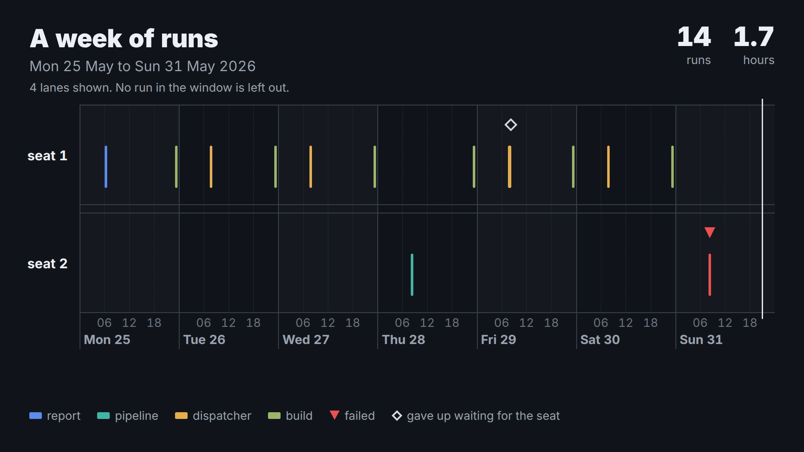

# A week of runs, as a picture

`lanes report` prints a week of the run log as a table. `lanes report --export` writes the same
week as an anonymised file, and `build.py` turns that file into a 30-second video: one swimlane
per seat, the week playing left to right. This folder holds the template, the allowlist for the
demo database and an export of the demo week.



## The table

```
bin/lanes report                       # the last full Monday-to-Sunday week
bin/lanes report --week 2026-05-25     # the week that starts on that Monday
bin/lanes report --days 3              # the last 72 hours
bin/lanes report --json                # the same numbers as JSON
```

Per seat and per lane: runs, how many ended ok, failed (`error` or `timeout`), locked, and
minutes run, with a total per seat and for the week. A run belongs to the window it started in.
Minutes come from each run's own start and end stamps, not from a stored duration. There is no
cost column on purpose: a dollar figure reads as a bill, and a seat's subscription is not billed
per run.

**What `locked` means.** The runner takes one lock per seat. A run that waits for the lock past
`LANE_LOCK_WAIT` gives up and is logged as `locked`, with its start and end both stamped at the
moment it gave up. How long it waited is not stored, and a run that waited and then got the seat
looks like any other run. So a locked mark is a run that waited and gave up, at the time it gave
up, and nothing here draws a wait.

## The export

```
bin/lanes report --week 2026-05-25 --export week.json --kinds my-kinds.toml
```

The kinds file is an allowlist. It maps a lane name to one of five generic kinds:

```toml
[kinds]
weekly-digest = "report"
repo-lint = "build"
dispatcher = "dispatcher"
pipeline-followup = "pipeline"
```

The kinds are `report`, `pipeline`, `render`, `dispatcher` and `build`. A lane the file does not
name is left out of the export, never passed through, and only counted. Seats are renamed
`seat 1`, `seat 2`, in the alphabetical order of their real names; a seat with no allowlisted run
in the window does not appear.

What the export holds:

| Field | What |
|---|---|
| `window` | start and end of the window (local time), its length in days and seconds |
| `seats` | the seat labels, in lane order top to bottom |
| `kinds` | the kinds that have at least one run |
| `lanes_shown` | how many allowlisted lanes ran in the window |
| `runs_left_out` | runs in the window from lanes the allowlist does not name |
| `totals` | runs, ok, failed, locked, seconds and minutes, over the runs shown |
| `runs` | per run: seat label, kind, `start_s` and `end_s` in seconds from the window's start, status |

No lane name, seat name, log path, summary, session id, token count or cost goes in. If
`runs_left_out` is above zero, whatever is made from the file has to say so: the gaps in the
picture are then lanes you chose not to show, not idle time.

## The demo week

`demo-week.json` is an export of the demo database, so every run in it is made up. The demo
seed dates its runs back from the moment it is run, so the file was made with a fixed clock:

```
bin/lanes seed-demo /tmp/lanes-demo --at 2026-06-01T12:00
export LANES_DB=/tmp/lanes-demo/lanes.db LANES_DIR=/tmp/lanes-demo/lanes LANES_LOG_DIR=/tmp/lanes-demo/logs
bin/lanes report --week 2026-05-25
bin/lanes report --week 2026-05-25 --export examples/week-video/demo-week.json \
  --kinds examples/week-video/demo-kinds.toml
```

That week has 15 runs on two seats: 13 ok, 1 failed, 1 locked, 105.9 minutes. All six demo lanes
are on the allowlist, so nothing is left out and the export's totals equal the table's.

## The video

`build.py` (Python standard library) reads one export and writes `build/index.html`, a page
with a paused GSAP timeline that the HyperFrames CLI renders frame by frame in a local headless
Chrome. It needs Node.js for `npx`; nothing is installed in this repo and nothing is rendered in
a cloud. The page loads GSAP from a CDN, so the render needs the network once.

```
cd examples/week-video
python3 build.py demo-week.json                     # or your own export
npx --yes hyperframes@0.9.23 render build --workers 2 -o build/renders/week.mp4
```

Options: `--title` (default "A week of runs"), `--width` and `--height` (default 1920 and 1080;
`--width 1080 --height 1920` is a vertical cut), `--out` (default `build/`). The video is 30
seconds at 30 fps and silent. `build/` is not tracked.

What is on screen:

| Mark | Means |
|---|---|
| a coloured block | one run, coloured by its kind, from its start to its end |
| a red block with a red triangle above it | a run that ended `error` or `timeout` |
| an open diamond | a run logged `locked`: it waited for the seat and gave up, drawn when it gave up |
| the counts top right | runs started and hours run so far, up to the playhead |
| the line under the dates | how many lanes are shown, and how many runs were left out |
| the closing frame | the export's totals: runs, ok, failed, gave up, hours and minutes, seats |

Blocks are drawn to scale, with one exception: on a seven-day window a run shorter than about
36 minutes would be under 6 pixels wide at 1080p, so it is drawn 6 pixels wide. Its start is true; only its width
is rounded up. Every number on screen comes from the export, and the closing totals are the
export's `totals`, so for a week with nothing left out they equal `lanes report --json` for the
same week.
